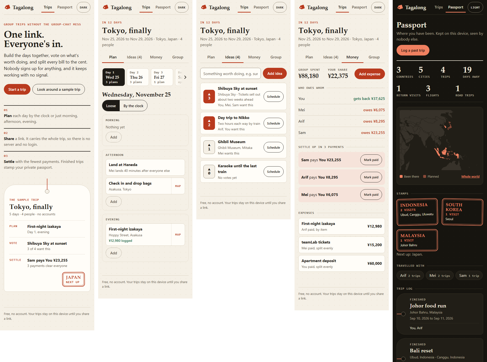

# Tagalong

Plan a trip with your group, vote on ideas, split every bill to the cent, and keep a private travel history.
No account, no server, works offline. Free.

Live: https://juw12.github.io/tagalong/ (add `?demo=1` to open it with sample trips)
Android APK and iPhone sideload IPA: https://github.com/juw12/tagalong/releases/latest (free; see [docs/install.md](docs/install.md))



## What it does

**Plan together**
- Trips with one or more stops, and a day-by-day itinerary. Each day is either loose (Morning / Afternoon / Evening) or on the clock, your choice per day.
- Clock days show the free gaps between events, and one tap fills a gap.
- Drag an event to another day or block, or use the edit sheet (works with keyboard and touch).
- Ideas shortlist with votes. The most wanted idea floats to the top; one tap schedules it.
- Saved places in collections (Food, Sights, a friend's tips). One tap turns a place into an idea.
- Organizers and members. Organizers edit the trip and the people and can lock the plan, so only they move
  days and times while everyone still adds ideas, votes and logs expenses. Roles are kept by the app on every
  copy; they are not a password.
- Every delete has Undo.
- On a phone the day strip fades at the edge and has an arrow button, so later days are never hidden.
- The first screen shows a sample trip as a luggage tag (stops, people, next event, who owes whom),
  so you see what a planned trip looks like before you make one.

**Split the money**
- Even split, split by shares, or itemised with tax and tip spread in proportion.
- Scan a receipt with the camera, or paste its text, and it becomes line items with tax pulled out.
  The reading (Tesseract OCR, bundled with the app) happens on the phone; the photo is never uploaded.
- Any currency per expense, with the rate you actually paid.
- Balances per person and the fewest transfers that settle everyone.
- All sums run in integer minor units, so the parts always add up to the bill exactly.

**Share without accounts**
- "Invite", on every tab, makes a link that carries the whole trip. Whoever opens it gets the trip on their device.
- Live sync, free and without accounts: changes reach everyone within seconds. Each trip gets a random 256-bit key
  that only travels inside invite links (after the `#`, which browsers never send anywhere). Every change is
  encrypted with AES-GCM and passed through two free public MQTT relays (broker.emqx.io, broker.hivemq.com) as a
  retained message, so someone who was offline catches up when they open the app. The relays only see ciphertext
  on a topic made from a hash of the key.
- Without live sync, opening someone's link merges both copies: the newest edit of each item wins, votes add up.
- Export the whole plan to any calendar app (.ics).

**Passport**
- Finished trips turn into a travel history by themselves: countries, cities, return visits, flights,
  road trips, days away, who you travel with most, and a world map you can drag, pinch and zoom. On a phone it
  opens zoomed to the countries you have been to, with a "Whole world" switch.
- Backup and restore as one JSON file.

## How it compares

Compared with the public App Store listing of "Otw: Group Trip Planner" (v1.2.0) and the trytraveler.com pitch,
read on 2026-11-13. Only listed features are compared; neither app was installed.

| | Tagalong | Otw | Traveler |
|---|---|---|---|
| Clock or Morning/Afternoon/Evening days, free gaps, drag and drop | yes | yes | not listed |
| Shortlist of ideas | yes, with votes | yes | not listed |
| Expenses: even, by item, tax + tip, currencies, settle up | yes | yes | not listed |
| Receipt | camera scan (on the phone) or paste | camera scan | not listed |
| Invite by link | yes, no account | yes, sign-in needed | not listed |
| Live sync between phones | yes, end-to-end encrypted, no account | yes | not listed |
| Organizer and member roles | yes | yes | not listed |
| Saved-place collections | yes | yes | not listed |
| Travel history: countries, cities, return visits, flights, road trips | yes | not listed | yes |
| Photos in history | one cover photo per trip | not listed | yes |
| Platforms | any browser, Android APK, iPhone by sideload or home screen | iPhone | iPhone |
| Works offline | yes, fully | viewing | not listed |
| Price | free | not checked | not checked |

Where Tagalong is still weaker: it is not in the App Store or Google Play (both charge to publish; see
[docs/install.md](docs/install.md) for the free routes), live sync depends on free public relays with no uptime
promise (invite links still work without them), roles are enforced by the app rather than by a server, and the
photo side of the travel history is one cover photo per trip.

## Run it

It is a static site with zero dependencies.

```
python -m http.server 8080
```

Open http://localhost:8080/ . On a phone, use the browser's "Add to Home Screen" to install it.

## Test it

```
node --test tests/
python tests/e2e.py          # layout, contrast, tap targets, offline, the whole flow
python tests/features.py     # roles, lock, places, map gestures, receipt OCR, live sync between two browsers
python tests/live_public.py  # live sync over the real public relays (needs internet)
```

The first runs the unit tests for the money maths, merge and share link. The second drives a real browser
(Playwright) through the whole flow and checks layout, contrast, tap targets and offline start.

## Files

- `index.html`, `styles.css`, `app.js`: the app
- `core.js`: pure logic (splits, balances, settle-up, merge, share link, history, calendar export, roles)
- `live.js`: live sync (AES-GCM, a minimal MQTT-over-WebSocket client)
- `vendor/ocr/`: Tesseract.js 5.1.1 and its English model (Apache-2.0), loaded only when you scan a receipt
- `native/`, `.github/workflows/native.yml`: the Android and iOS builds, made on GitHub's free runners
- `world.js`: world map shapes, built by `tools/build_world.py` from Natural Earth (public domain)
- `sw.js`, `manifest.webmanifest`: offline shell and install metadata
- `design.md`: the visual identity and its rules
- `hone/refine_log.md`: the rubric, the scores and every round of the improvement loop

## Privacy

Everything stays in this browser's storage. Data leaves the device only as a link or backup file you choose to
send, or, if you turn live sync on, as encrypted snapshots that the relays cannot read. An invite link contains the
trip and (with live sync) its key, so treat it like the trip.

## License

MIT. Map data from Natural Earth. OCR by Tesseract.js (Apache-2.0).
